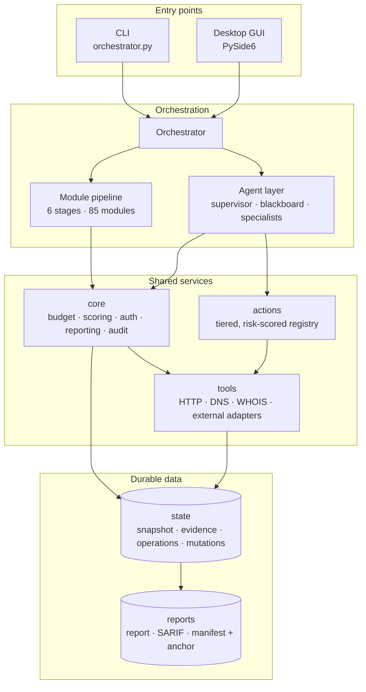
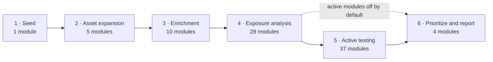
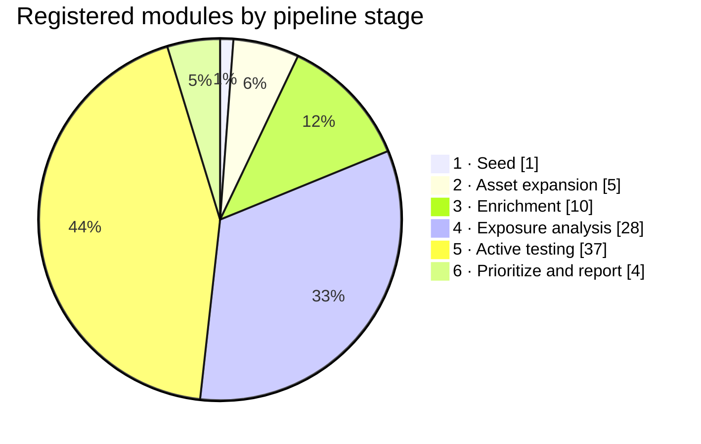
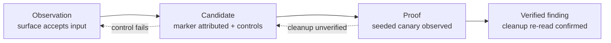
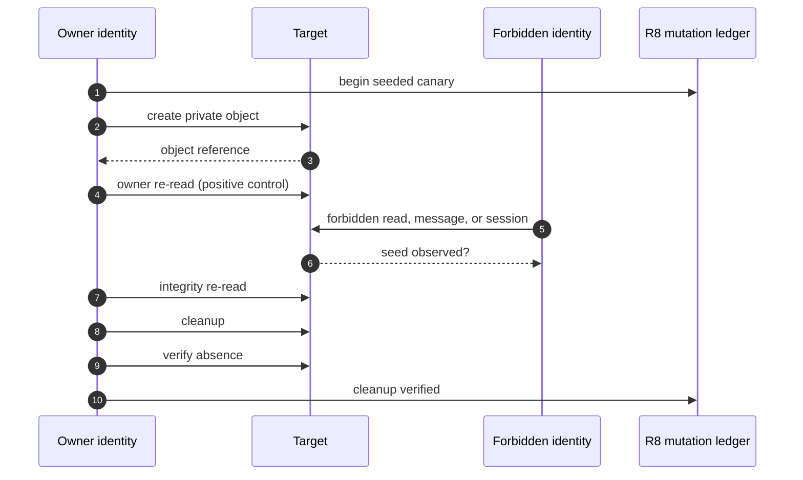

# OSINT Agent

**LLM-orchestrated OSINT & bug-bounty reconnaissance pipeline** — maps a target's
external attack surface, enriches discovered assets, records evidence, prioritizes
findings, and generates reports or attack plans.

[](https://github.com/roxm337/osint-agent/actions/workflows/ci.yml)


---

## Authorized use only

This is an **offensive security tool**. Reconnaissance, scanning, and active testing
against systems you do not own or lack **explicit written authorization** to test may
be illegal in your jurisdiction.

The framework does not enforce an engagement scope or prove authorization. It does
default active modules and autonomous exploitation to off, and applies a configurable
risk ceiling when execution is enabled. You remain responsible for operating within
the law and the rules of engagement for the target.

---

## At a glance

| | |
|---|---|
| **Pipeline** | 85 registered modules across 6 stages; 35 active/high-detectability capabilities are opt-in |
| **Orchestration** | Deterministic pipeline, LLM-guided module selection, and a risk-tiered multi-agent layer |
| **Evidence** | Hash-chained operation and mutation ledgers, verified cleanup, evidence manifests + external anchor |
| **Proof discipline** | Candidates stay unverified; only a seeded canary observed by the forbidden identity becomes a finding |
| **Compatibility** | Python 3.10–3.12, headless CI matrix plus an offscreen GUI job |
| **Tests** | 1,521 passed, 34 skipped (non-GUI suite, local) |

---

## Architecture



Two generations coexist by design:

1. **Module pipeline** (`orchestrator.py` + `modules/*`) — mature and tested, the working product.
2. **Autonomous agent layer** (`agents/*`, `actions/*`) — a risk-tiered multi-agent system
   for planning and execution, with deterministic fallbacks and plan-only defaults for
   exploitation and verification.

---

## Pipeline





| Stage | Focus | Example modules | Detectability |
|---|---|---|:---:|
| 1 · Seed | Seed target assets | `seed_discovery` | low |
| 2 · Asset expansion | Subdomains, history, contacts | `subdomain_enum`, `wayback_machine`, `asn_expansion` | low |
| 3 · Enrichment | Tech, TLS, mail, threat intel, CVEs | `tech_detection`, `tls_audit`, `exploit_lookup`, `port_scan` | low–high |
| 4 · Exposure analysis | APIs, misconfig, secrets, takeover | `rest_api_audit`, `graphql_audit`, `misconfig_probes`, `dns_takeover` | low–medium |
| 5 · Active testing | Vuln validation | `nuclei_scan`, `xss_scan`, `sqli_scan`, `content_discovery` | **high** |
| 6 · Prioritization and reporting | Score, plan, report, submit | `risk_prioritization`, `attack_planner`, `reporting` | low |

---

## Evidence discipline

The framework separates what a scanner **suspects** from what an assessment can **prove**.
Only the seeded-canary path reaches a verified finding.





- **R7 operation ledger** — every started, refused, failed, or cancelled operation gets
  one terminal hash-chained row at `state/operations.jsonl`.
- **R8 mutation ledger** — every seed is recorded before creation, cleanup is only
  `verified` after a fresh re-read, and outstanding rows are surfaced and retried.
- **No timing-only promotion.** Handshake acceptance, response differences, and model
  compliance are observations or candidates, never proof.
- **Redacted capture.** Credential headers are dropped and bodies are scrubbed at capture
  time; stored evidence never carries live sessions.

---

## Capability coverage

| Capability | What it establishes | Core surfaces |
|---|---|---|
| Authorization matrix | Cross-identity object/field access with revocation and canary proof | `core/authorization.py`, IDOR/BFLA/GraphQL modules |
| Browser traffic replay | Redacted XHR/WS capture replayed with fresh identities | `core/traffic.py`, `core/workflows.py` |
| WebSocket authorization | Handshake origin, message authz, subscriptions, post-logout reads | `tools/websocket_engine.py`, `modules/websocket_audit.py` |
| MCP assessment | Tool/resource authorization, session-id reuse, cross-audience access | `tools/mcp_engine.py`, `modules/mcp_audit.py` |
| AI conversation isolation | Cross-identity thread reads, cross-thread continuation, retrieval leakage | `modules/ai_conversation_audit.py` |
| Client-side path traversal | Browser-driven URL input flow with resolved-path impact probes | `core/urlpaths.py`, `modules/cspt_audit.py` |
| ORM/filter leaks | Filter-shaped access-control leaks isolated from direct-read IDOR | `modules/orm_filter_audit.py`, `tools/orm_source_rules.py` |
| Stateful invariants and races | Single-use, balance, stock, idempotency, uniqueness under bounded concurrency | `core/invariants.py`, `modules/business_logic.py` |
| Credential lifecycle | `env:`/`file:` references, expiry, revocation, preflight enforcement | `core/secrets.py`, `core/auth_harness.py`, `core/keyvault.py` |
| Evidence integrity | Hash-chained ledgers, SHA-256 manifests, external-anchor export | `core/results.py`, `core/mutations.py`, `core/evidence_manifest.py` |
| Model boundary | Target content framed as untrusted; provider/data policy fails closed | `core/untrusted.py`, `agents/*`, `agents/__init__.py` |

### Verification

| Gate | Result |
|---|---|
| Non-GUI pytest suite | **1,521 passed, 34 skipped** |
| CI matrix | Python 3.10, 3.11, 3.12 + offscreen GUI job |
| Live lab | Browser capture/replay against Juice Shop (localhost) |
| Twin labs | Authorization, CSPT, ORM/filter, race, WebSocket, MCP, conversation |
| Evidence checks | Manifest/anchor tamper tests, verified-cleanup gates, redacted exports |

---

## Installation

Requires **Python 3.10+**.

```bash
# 1. Clone
git clone https://github.com/roxm337/osint-agent.git osint-agent && cd osint-agent

# 2. Virtual environment
python3 -m venv .venv
source .venv/bin/activate        # Windows: .venv\Scripts\activate

# 3. Core dependencies
pip install -r requirements.txt

# 4. (Optional) browser-rendered crawl and CSPT checks
playwright install chromium
```

Or install as a package (exposes the `osint-agent` and `osint-agent-gui` commands):

```bash
pip install -e .            # core
pip install -e ".[full]"    # + aiohttp, dnspython, whois, bs4, lxml, playwright
```

---

## Configuration

The repository ships templates; your real config and secrets stay local (git-ignored).

```bash
cp config.example.yaml config.yaml   # runtime config
cp .env.example .env                 # API keys / LLM credentials
```

- **`config.yaml`** — target, run mode, rate limits, wordlists, scoring weights,
  detectability metadata, authenticated identities, and optional API keys.
- **`.env`** — environment fallbacks for third-party keys and LLM credentials.

### Credential references

Credential values may be references resolved at use time:

```yaml
auth:
  require_secret_refs: true
  identities:
    user_a:
      bearer_token: "env:TARGET_BEARER"
      verify_url: "https://target/api/me"
      expires_at: "2026-12-31T00:00:00Z"
      revoked: false
```

- `env:NAME` and `file:/path` are resolved in memory only; resolved values never reach
  state, evidence, or reports.
- Expired or revoked credentials are refused, and preflight reports them before the run.
- `api_keys.*` accepts the same references.

### Model policy

```yaml
llm:
  allowed_providers: [ollama]     # empty = unrestricted
  data_policy:
    mode: local_only              # standard | redacted | local_only
```

Agents frame every target-derived prompt string as untrusted data: control characters
stripped, credentials redacted, boundary markers defanged, and a policy line prepended
once. `local_only` rejects remote providers at configuration time.

---

## Usage

### CLI

```bash
# Passive reconnaissance (default)
python orchestrator.py -t example.com

# LLM-guided module selection
python orchestrator.py -t example.com --mode llm

# Generate a testing plan for a selected assessment
python orchestrator.py -t example.com --run-mode resume --assessment ASSESSMENT_ID --module attack_planner

# Active recon (port scan + high-detectability probes)
python orchestrator.py -t example.com --active

# Active vulnerability scanning pass
python orchestrator.py -t example.com --active --pentest

# Autonomous multi-agent planning/recon (exploit and verify remain plan-only)
python orchestrator.py -t example.com --agent --phase recon

# Deliberately execute agent actions up to the selected risk ceiling
python orchestrator.py -t example.com --agent --execute --max-risk MEDIUM

# Utilities
python orchestrator.py -t example.com --list-modules
python orchestrator.py -t example.com --list-actions
python orchestrator.py -t example.com --tools
```

**Key flags:** `-t/--target` (required), `-o/--output` (default `reports`),
`-c/--config` (default `config.yaml`), `--mode {auto,llm}`, `--module <id>`,
`--active`, `--pentest`, `--agent`, `--execute`,
`--max-risk {SAFE,LOW,MEDIUM,HIGH,DESTRUCTIVE}` (default `DESTRUCTIVE`),
`--max-actions` / `--max-chains` (default `0` = unlimited), `--resume-budget`,
`--run-mode {fresh,resume,retest}`, `--assessment ID`, `--from-assessment ID`,
`--list-assessments`, `--import-legacy DIRECTORY`,
`--phase {plan,recon,vuln,exploit,verify,report}`,
`--list-modules`, `--list-actions`, `--tools`, `--install-tools`.

### GUI

```bash
python -m gui.app        # or: osint-agent-gui
```

The GUI drives the same `orchestrator.py` engine via `QProcess`, so GUI and CLI share
identical state and config contracts.

- **Six-screen console** — Run, Triage, Graph, Data, Report, Settings; `Ctrl+1..6` jumps
  between screens.
- **Live run feedback** — status pill, progress bar, and completed/skipped/blocked/
  incomplete/request metrics polled from `state/module.json`.
- **Mission lifecycle** — Fresh / Resume / Retest plus an origin-specific assessment
  selector; reports and attack plans operate on the selected assessment.
- **Findings triage** — search/filter, multi-select verdicts (`true_positive` /
  `false_positive` / `out_of_scope` + notes) persisted outside the engine state.
- **Attack graph** — observed edges vs. proposed probes with the probe-plan summary.
- **Settings** — LLM, runtime limits, scanner identities, action risk list, tools, API
  keys, raw YAML, and File → "Use Config File…".
- **Shortcuts** — `Enter` run, `Ctrl+Return` Run/Operation menu, `F5`/`Ctrl+R` reload,
  `Ctrl+O` config, `Ctrl+Q` quit. The dark theme lives in `gui/theme.qss`.

---

## Run model

Modules carry `detectability` (`low` / `medium` / `high`) and `active` metadata.
Deterministic and LLM-guided pipeline runs exclude active modules by default;
`--active` includes them. An explicitly named `--module` is treated as an intentional
direct request. Autonomous exploit and verify phases require `--execute`, and every
agent action is checked against `--max-risk` immediately before execution.

One engagement budget is shared by pipeline modules and autonomous agents. The request
counter covers HTTP calls made through the framework wrappers, while
`max_external_commands` caps scanner/tool process launches. External scanners such as
Nuclei or sqlmap still enforce their own configured request rates because their internal
traffic is outside the wrapper.

Budget counters are checkpointed to the selected assessment's `state/budget.json`
after each reservation. Fresh/retest starts with new counters; resume restores the
selected assessment's counters and verifies checkpoint identity. Stopped time is not
charged against the wall-clock limit. The CLI lifecycle overrides the standalone
`budget_limits.resume` default; `--resume-budget` is only a compatibility flag for an
explicitly selected resume.

### Assessment lifecycle and migration

Canonical origin includes scheme, hostname and port. Paths/query strings do not create
new service namespaces; explicit default ports, IDNA names and equivalent IPv6 spellings
normalize to the same origin. HTTP vs HTTPS and different ports do not share state.

| Lifecycle | Selection | State behavior |
|---|---|---|
| `fresh` (default) | Optional new ID | New empty assessment; no old completion, findings, evidence or budget. |
| `resume` | Required assessment ID | Continue that assessment's state, evidence, audit and budget. Full pipelines skip its completed modules; an explicitly selected module reruns. |
| `retest` | Required baseline ID | Create a new assessment linked to the baseline. Carry only history, never old findings, assets, credentials or completion flags. Missing baseline items remain untested without negative-retest proof. |

```bash
# Start a fresh assessment; the CLI prints its ID and output directory
python orchestrator.py -t http://localhost:3000

# List only this exact origin's assessments (no scan, no new directories)
python orchestrator.py -t http://localhost:3000 --list-assessments

# Continue the assessment selected by ID
python orchestrator.py -t http://localhost:3000 --run-mode resume --assessment ASSESSMENT_ID

# A new retest with a selected history baseline
python orchestrator.py -t http://localhost:3000 --run-mode retest --from-assessment ASSESSMENT_ID

# Report-only processing never discovers/probes surface
python orchestrator.py -t http://localhost:3000 --run-mode resume --assessment ASSESSMENT_ID --module reporting

# Explicit copy of inactive legacy output; original files are unchanged; exits without scanning
python orchestrator.py -t https://example.com --import-legacy reports/example.com
```

New layout: `reports/services/<origin-key>/assessments/<assessment-id>/` contains
`assessment.json`, reports, triage, submissions, and `state/` with snapshot/evidence/
budget/audit data. A single executor lease protects each assessment; separate assessments
can coexist. Lifecycle controls select stored data, not engagement scope. Interrupted
modules restart at module boundaries on resume; this is not an in-flight HTTP/scanner
checkpoint. Abandoned running records are marked interrupted. Python API callers should
call `Orchestrator.close()` to checkpoint the budget and release the executor lease;
use separate processes for simultaneous assessments.

Legacy origin identity was not recorded reliably: importing explicitly declares the
origin of the copy. Stop any writer first. Imports refuse nested symlinks and invalid
state; existing files are copied, never moved/deleted. A failed import may leave an
unpublished destination for inspection; it is not a resumable assessment. Use the
printed imported ID for subsequent resume/report commands.

`BaseModule.http_get()` records WAF block/allow signals for reporting, and
`modules.max_consecutive_empty` caps unproductive probing per module — an efficiency
knob, not a safety control.

---

## Reports and evidence integrity

A report run writes:

- `<target>_report.md` and `<target>_executive_summary.md`
- `<target>_summary.json`, `<target>_findings.json`, `<target>.sarif`,
  `<target>_defectdojo.json`, `<target>_regression.json`
- proof-of-concept artifacts under the assessment's `pocs/` directory
- `evidence-manifest.json` — SHA-256 over evidence files, the state snapshot and the
  exported report artifacts
- `evidence-anchor.json` — the manifest hash for copying to an external system

A local hash detects corruption or local tampering, but it is **not a signature** and
cannot detect whole-store replacement. Only an externally stored anchor adds an
out-of-store reference. The anchor file states this explicitly.

---

## Testing

```bash
pip install pytest pytest-asyncio
python -m pytest                              # full suite (GUI tests need PySide6)
python -m pytest --ignore=tests/test_gui_app.py --ignore=tests/test_gui_graph.py
```

The suite covers core state, scoring, evidence, external-tool parsing, per-stage
modules, execution policy, the attack planner, the action registry, authorization
matrices, traffic replay, CSPT, ORM/filter leaks, invariants/races, WebSocket and MCP
authorization, conversation isolation, credential lifecycle, evidence manifests, and
the GUI. Run `python -m pytest --collect-only -q` for the current test count.

CI runs the non-GUI suite on Python 3.10, 3.11 and 3.12, plus an offscreen GUI job.
The non-GUI job intentionally omits optional browser/desktop packages; driver seams are
injected in tests so those checks do not depend on Playwright or PySide6 being installed.

---

## Project structure

```text
orchestrator.py      CLI entry point and module runner
config.example.yaml  runtime config template (copy to config.yaml)
.env.example         API-key / LLM credential template
agents/              autonomous multi-agent layer (supervisor, blackboard, agents)
actions/             tiered offensive action registry (web/api/auth/cloud/verify)
core/                scoring, prioritization, reporting, auth, secrets, evidence, audit
modules/             85 recon / enrichment / exposure / active modules
state/               persistent asset graph, findings, evidence, ledgers
tools/               HTTP/DNS/WHOIS transports + WebSocket, MCP and tool adapters
payloads/            payload catalogs for active checks
gui/                 PySide6 desktop application
tests/               pytest suite and lab gates under benchmarks/
.github/             CI matrix and GUI job
```

---

## Design notes

The distinguishing element is not the individual recon checks (those are table stakes),
but the **orchestration and evidence layer around them**:

- A **typed action registry** where every capability is a declared, catalogued action
  with required parameters, risk metadata, and a timeout.
- **LLM-guided, then multi-agent, orchestration** that plans, sequences, and executes
  actions, with a supervisor, blackboard, and verification agents confirming findings.
- **Evidence-first grading** — observations, candidates, and proof are separate states;
  seeded canaries and verified cleanup are required before a finding is confirmed.
- **Hostile-input handling** — all target-derived prompt content is framed as untrusted
  data, and provider/data policies fail closed.
- **Credential and evidence lifecycle** — secret references, expiry/revocation, redacted
  exports, hash-chained ledgers, and externally anchorable manifests.

Together these make the tool an **auditable autonomous system** rather than a
fire-and-forget scanner. Targeting discipline remains the operator's responsibility.

---

## Status and roadmap

The module pipeline and the first integration wave are implemented and validated:
browser traffic replay, authorization matrices, CSPT, ORM/filter leaks, stateful
invariants and races, WebSocket authorization, MCP assessment, AI conversation
isolation, model-boundary hardening, and credential/evidence lifecycle.

Active work continues on the stateful API lab acceptance gate, the optional PyRIT
adapter (provider credentials are operator-supplied; nothing is installed or credentialed
by default), and the remaining cloud/artifact/scenario assessment packs. The internal
delivery ledger is operator-local and not part of the public repository.

Investigation data commits to `state/snapshot.json`; the four legacy JSON files are
compatibility exports. Concurrent stale saves raise a conflict instead of overwriting
newer state. History counts observation snapshots, not report exports; missing
findings/assets are **untested** without an explicit negative retest.

---

## License

No license is set yet. Until a `LICENSE` file is added, all rights are reserved and this
code is **not** licensed for reuse. Choose and add a license before publishing broadly
(e.g. MIT for permissive reuse, or a source-available license if you want to restrict it).

---

## Disclaimer

Provided for authorized security research and education only. The authors accept no
liability for misuse. Test only what you are explicitly permitted to test.
