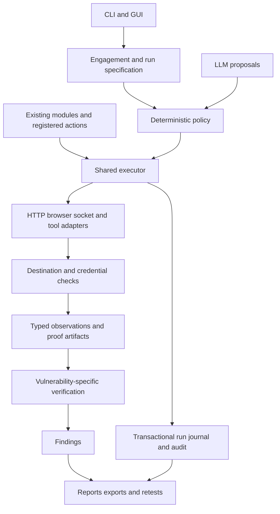

# Project review: readiness for professional red team engagements

Implementation follow-up: see [FIX_PROGRESS.md](FIX_PROGRESS.md) for the first batch of fixes and the remaining backlog. Findings below describe the original review snapshot.

Reviewed: 2026-10-24. Scope: the current working tree, including the existing edits to `modules/misconfig.py` and `tests/test_catch_all_server.py`. Those edits were preserved. This review adds this document; it does not implement fixes.

## Assessment

The project has a substantial foundation for external web assessment: 79 registered modules, 17 registered actions, authenticated comparison helpers, browser checks, a graph planner, request budgets, structured evidence, report exports, and a desktop interface. Several existing regression tests address real scanner failure modes rather than only checking mocks.

Its current maturity is best described as a capable web assessment framework with an experimental autonomous execution layer. Professional red team readiness is limited by execution boundaries, finding semantics, engagement isolation, cancellation, release packaging, and validation of complete operational workflows.

The highest-value next investment is a shared execution and evidence contract. Adding more scanners now would increase the number of places affected by the existing gaps.

### Validation performed

| Check | Result |
|---|---|
| Non-GUI test suite | **1,181 passed, 33 skipped**, 137.85 seconds |
| GUI test suite, offscreen | **70 passed**, 48.28 seconds |
| Combined completed suites | **1,251 passed, 33 skipped** |
| Installed dependency consistency | `pip check`: no broken requirements |
| Built distribution inspection | Wheel builds; four important resource types are missing; 94 test files are included |
| Additional local behavioral probes | Reproduced credential forwarding, policy bypasses, false finding promotion, origin collisions, lost updates, cancellation leakage, and graph path omission |

The first sandboxed suite attempts could not bind local test-server sockets, and Qt WebEngine aborted on macOS display access. The results above are from the completed runs with the required access. Those initial failures are not counted as product defects.

The local runtime was Python 3.14.7. The checked-in CI matrix covers Python 3.10–3.12. This review did not execute that matrix, a full live lab assessment, real external scanner compatibility tests, or a current dependency CVE audit. Passing `pip check` does not establish that dependencies are vulnerability-free. Skipped tests are not treated as verified coverage.

The graphify launcher referenced a missing Python 3.12 interpreter. Querying the existing graph worked using the available interpreter and installed graphify package path. Because graph metadata predates current source changes, source code was the authority for findings.

### Method and trust boundaries

The review examined seven input categories: CLI arguments; GUI run controls; YAML/environment configuration; target HTTP content and references; DNS/external-tool output; model-generated decisions and plans; and persisted state/knowledge data. The highest-priority traces followed target-controlled content into outbound requests, model proposals into execution, successful actions into findings, and cancellation into child processes.

Central execution, state, authentication, verification, graph, reporting, packaging, and CI paths were inspected, together with selected discovery and active modules. This was not a manual proof of every detection rule in all 79 modules. Additional reproductions used synthetic credentials, mocked network/model transports, temporary state, and one local sleeping child process, which was terminated after the cancellation check.

## Priorities

P0 means address before relying on unattended engagement execution or client-facing autonomous findings. P1 means address before a professional release. P2 means the next capability/maturity milestone. These priorities describe operational importance, not CVSS severity.

| Priority | Gap | Evidence |
|---|---|---|
| P0 | Credentials can accompany a target-controlled off-origin source-map fetch | Reproduced through the real module and wrapper with a mocked transport |
| P0 | Risk and active-mode controls are enforced inconsistently | Reproduced SAFE fallback and inactive LLM dispatch |
| P0 | Successful observations can become verified vulnerabilities | Reproduced normal JWT discovery becoming verified HIGH |
| P0 | Cancelling a tool task can leave its subprocess running | Reproduced with a local child process |
| P1 | State conflates services, runs, and concurrent writers | Reproduced port/scheme collision and lost update |
| P1 | Graph search misses valid paths; execution lacks chain dependency contracts | Search omission reproduced; executor inspected |
| P1 | Audit/evidence guarantees vary across execution paths | Source inspection |
| P1 | Built package omits runtime resources; toolchain builds drift | Wheel inspected; Docker/install definitions inspected |
| P1 | Evaluation does not measure complete framework precision and recall | Benchmark and CI inspected |
| P2 | Secrets, identities, and mutation cleanup need engagement lifecycle management | Source inspection |
| P2 | Traffic accounting differs across HTTP, browsers, raw sockets, and scanners | Source inspection |
| P2 | Mission planning and defensive validation need first-class models | Action metadata, supervisor, and reports inspected |
| P2 | Configuration, history, and orchestration need stronger schemas and ownership | Source inspection |

## Confirmed security finding

Standalone security findings: **0 Critical, 0 High, 1 Medium**. The execution and correctness defects below use separate operational priorities; they are not presented as independently scored remote vulnerabilities.

### S1 — [MEDIUM] Target-controlled source-map references receive target credentials

**Priority:** P0. **Confidence:** confirmed by a local execution trace. **CWE:** CWE-201, insertion of sensitive information into sent data. **OWASP Top 10 2021:** A02, Cryptographic Failures, sensitive data exposure. **CVSS v3.1:** 6.5, `CVSS:3.1/AV:N/AC:L/PR:N/UI:R/S:U/C:H/I:N/A:N`.

The score conservatively covers credential disclosure to a remote recipient when an operator runs an authenticated assessment. Further account impact depends on the credential's permissions and was not tested.

**Source and path:**

1. A target JavaScript response supplies an absolute `sourceMappingURL`.
2. `modules/js_analysis.py:539` extracts that reference and adds it to `source_maps` without the scope check applied to the JavaScript files themselves.
3. `modules/js_analysis.py:594` calls `curl_with_status(map_url)` on it.
4. `tools/wrappers.py:465` merges globally configured target credentials into the request unless a caller explicitly opts out.
5. `tools/wrappers.py:491` sends those headers to the supplied destination.

Relevant code:

```python
# modules/js_analysis.py
if not map_url.startswith("http"):
    map_url = js_url.rsplit("/", 1)[0] + "/" + map_url
source_maps.append(map_url)

for map_url in source_maps[:5]:
    r = await curl_with_status(map_url)
```

**Observed:** a first-party mock `/main.js` referenced `https://outside.invalid/review.map`. Running `JSAnalysis.run()` with a synthetic bearer credential caused one request to that destination with `Authorization` attached. No real credential or external request was used.

**False-positive challenge:** third-party enrichment helpers already strip target authentication, and first-party JavaScript selection already checks scope. Neither mitigation applies to this later source-map reference: the local trace reached the normal wrapper with target authentication present.

**Remediation:** associate credentials with an explicit allowed origin set and select them at the final request boundary. Canonicalize references and authorize destinations before network I/O. An external reference should be recorded as discovery data; fetching it requires the appropriate egress policy and a separate credential decision. Validate every redirect before following it. Apply the same rules to browser subresources and external tool input.

**Related source-reviewed exposure:** `modules/browser_crawl.py:334` creates contexts using `extra_http_headers=auth_headers`. Playwright documents these headers as applying to every request. Filtering discovered links after rendering does not constrain requests already made by the page. This path warrants a browser integration regression test alongside the reproduced source-map case. See [Playwright Browser.new_context](https://playwright.dev/python/docs/api/class-browser#browser-new-context-option-extra-http-headers).

## Confirmed execution and correctness defects

### D1 — P0: blocked actions can fall through into unclassified probes

**Locations:** `agents/exploitation_agent.py:71`, `agents/exploitation_agent.py:99`, `core/verification_oracle.py:423`, `agents/base_agent.py:134`.

`_generic_probe()` retains only results that were not blocked. When every candidate exceeds the risk ceiling, it returns `None`. `test_hypothesis()` then selects `_fallback_test()`, which calls HTTP and the XSS oracle directly.

**Reproduction:** an unknown-technique hypothesis against a parameterized URL, with a `SAFE` ceiling, made one direct request and four oracle requests while charging **zero actions**. Registered actions were blocked, but the fallback still sent XSS payloads.

The fallback also returned `CONFIRMED` when the mock server reflected the payload inside an inert `<textarea>`. This demonstrates that an older verification helper has a weaker proof standard than the main reflected-XSS path.

**Required change:** distinguish `blocked`, `unsupported`, `negative`, `inconclusive`, and `error` outcomes. A blocked result must remain terminal for that action family. Every fallback must be a registered capability subject to the same policy, timeout, budget, identity, and audit checks. Retire or constrain legacy helpers that promote reflection into execution proof.

**Acceptance:** SAFE runs send no higher-risk payloads, including unknown-technique and exhausted-budget paths; inert HTML reflections never count as confirmed XSS.

### D2 — P0: LLM module selection bypasses the active-mode execution gate

**Locations:** `agents/orchestrator_agent.py:106`, `orchestrator.py:382`, `orchestrator.py:694`.

The agent hides active modules from its suggested list, but `run_llm()` accepts any registered, unfinished module returned by the model. It does not enforce the active flag before calling `_run_module()`.

**Reproduction:** a mocked model returned `RUN_MODULE:nuclei_scan` while `target.active` was false; the dispatcher invoked that module. The diagnostic replaced module execution with a recorder, so no scanner ran.

**Required change:** validate the requested operation against a deterministic execution policy after parsing the model response. Proposal filtering and prompting are advisory. Preserve the operator's intentional single-module workflow through an explicit execution intent, rather than letting model decisions inherit that authority.

**Related ambiguity:** `--max-risk` defaults to `DESTRUCTIVE` in the parser and runner, despite several comments/examples describing LOW defaults. All shipped engagement budget dimensions default to unlimited. Also, modules labeled non-active include AXFR, exposure probes, and login enumeration. Separate passive collection, direct discovery, active testing, and state-changing testing in documented profiles.

### D3 — P0: successful capability discovery becomes a verified HIGH vulnerability

**Locations:** `actions/auth/jwt.py:106`, `agents/exploitation_agent.py:247`, `agents/verification_agent.py:101`.

`auth.jwt.detect` succeeds when it discovers and decodes a JWT. `_record_result()` translates any successful action into an `Exploitable:` finding, assigning HIGH when confidence is FIRM or CONFIRMED. Verification reruns the discovery action and can mark that finding verified.

**Reproduction:** a synthetic response containing a normal-shaped HS256 JWT became a **HIGH / CONFIRMED / verified** exploitation finding. No weak signature, sensitive claim, authorization bypass, or other JWT vulnerability was present in the fixture.

**Required change:** give results explicit types: observation, candidate, demonstrated vulnerability, and execution outcome. Metadata already has a `produces` field; enforce its meaning. A successful discovery action should create an asset/observation. Require a vulnerability-specific proof predicate before creating or confirming a finding. Store which action actually produced the result, including when a fallback changed it.

**Acceptance:** normal JWT issuance, reachable pages, ordinary headers, and valid API responses stay observations; positive vulnerability fixtures still produce findings with concrete proof.

### D4 — P0: cancellation can leave tools running after their task ends

**Locations:** `tools/external.py:290`, `tools/wrappers.py:259`, `tools/wrappers.py:330`, `gui/app.py:3128`.

Tool helpers terminate children on their own `TimeoutError`, but do not handle cancellation of the surrounding coroutine. Child processes start in a new session on POSIX. Terminating the GUI's parent process is not a complete child-process lifecycle strategy.

**Reproduction:** started a local Python child sleeping for 30 seconds through `run_command()`, cancelled its task, and observed the child still running. The review then explicitly terminated that child. No scanner or network activity was involved.

**Required change:** track all child processes and containers per engagement. Handle `CancelledError` with bounded, cancellation-safe cleanup and re-raise it. Persist mutation cleanup obligations before writes. For Docker jobs, track container identity and explicitly stop containers on cancellation; terminating the Docker CLI alone is insufficient as a design guarantee.

**Acceptance:** module timeout, action timeout, Ctrl+C, GUI Stop, and application shutdown leave no managed processes or containers behind; outstanding target cleanup is recorded.

### D5 — P1: different services and runs share progress; independent writers lose data

**Locations:** `orchestrator.py:158`, `orchestrator.py:178`, `orchestrator.py:299`, `state/manager.py:86`, `state/manager.py:610`, `state/manager.py:651`.

State is stored under `output/<hostname>`. Scheme, port, engagement, run, configuration, identity set, and scanner version are not part of that identity. A new run loads previous module completion flags and can skip completed modules indefinitely.

**Reproduction:** after marking `tech_detection` complete for `http://example.test:8000`, constructing a run for `https://example.test:9000` under the same output root loaded that completion flag.

**Separate reproduction:** two `StateManager` instances opened the same initially empty directory. Writer A saved asset A; writer B then saved asset B from its older snapshot. Reloading showed only asset B. Atomic file replacement prevents partial JSON reads but does not prevent lost updates. Four separately replaced state files also do not form one transaction. Corrupt JSON currently falls back silently to an empty default.

**Required change:** introduce engagement ID, run ID, canonical origin, input/config digest, identity references, and versioned schemas. Separate durable asset history from per-run observations and module status. Provide explicit fresh/resume/retest behavior. SQLite transactions and a single writer are a proportionate next step; a distributed database is not necessary for the present desktop/CLI architecture.

**Acceptance:** services on different ports do not reuse test completion; concurrent saves preserve both updates; resume validates its inputs; corruption produces an explicit recovery state.

### D6 — P1: graph search discards valid paths, and edge probes are not dependency-aware chains

**Locations:** `core/attack_graph.py:597`, `core/attack_graph.py:329`, `core/chain_executor.py:404`.

The graph search uses one visited set per start node. A node first reached through a weak path is not reconsidered when a later, stronger path reaches it. The queue is breadth-first rather than ordered by path quality.

**Reproduction:** edges `start -> goal` with score 0.1, `start -> middle` with score 0.9, and `middle -> goal` with score 0.9. At threshold 0.3, the valid 0.81 path from `start` was absent because the direct goal had already been visited. A path from `middle` was returned, but that does not recover the missing chain from `start`.

The executor additionally sorts planned edges by reason and runs them independently. It has no general contract for passing an acquired identity/resource into a downstream action, checking predecessor success, or preventing dependent steps after failure. Some inferred edges connect nodes by vulnerability category rather than a proven endpoint/identity relationship.

**Required change:** separate a collection of independent probes from a causal chain. Use bounded path search with path-local cycle detection or a suitable best-path/top-k algorithm. Add explicit preconditions, typed outputs, artifact bindings, postconditions, and cleanup requirements to causal steps. Treat multiplied heuristic scores as ranking values, not calibrated probabilities of compromise.

**Acceptance:** the alternate 0.81 path is preserved; downstream steps cannot run on an unmet prerequisite; an unrelated endpoint cannot inherit another endpoint's vulnerability or identity.

### D7 — P1: the built wheel omits resources needed outside the checkout

**Locations:** `setup.py:17`, `setup.py:27`, `knowledge/__init__.py:23`, `gui/app.py`, `orchestrator.py:229`.

A locally built `osint_agent-1.0.0-py3-none-any.whl` omitted:

- `config.example.yaml`
- `gui/theme.qss`
- `knowledge/juice_shop_lab.yaml`
- `rules/semgrep/js-sinks.yaml`

It also included 94 test files because package discovery is unrestricted. A successful checkout run therefore does not demonstrate a functional installed distribution. `h2` is in `requirements.txt` but absent from the package extras, adding another installation-route difference.

**Required change:** explicitly declare runtime package data and use `importlib.resources` where appropriate. Exclude tests from runtime packages. Define core/GUI/browser/tooling extras with consistent dependency declarations. Build and install the wheel in an isolated directory in CI, then exercise CLI, theme loading, rule lookup, and knowledge-pack loading.

**Acceptance:** an installed wheel works without the repository or current working directory supplying resources.

## Additional professional-readiness gaps

### P1: audit coverage and evidence integrity need one contract

`core/audit_log.py` is a useful start: it sanitizes structured event data and chains records. However, the normal orchestrator does not establish the same audit lifecycle as `AgentSupervisor`; `_execute_chains()` constructs `ChainExecutor` without an audit object. `ActionRegistry.execute()` only records when one is supplied. A statement that every executed action is audited is therefore too broad.

`state/manager.py:584` stores evidence without a content digest or schema version. `core/reporting.py:781` emits an evidence metadata digest in the descriptive sense, not a cryptographic content hash. The hash chain does not authenticate those external evidence files. An unanchored chain also cannot prove that a valid suffix was not removed or that the whole chain was not recomputed.

Add mandatory intent/start/end/error/cancel events for all execution paths, including blocks and fallbacks; reference evidence content hashes; include run/config/tool/template versions; and anchor finalized manifests outside the writable run directory when stronger integrity is required. Avoid calling the current local chain tamper-proof.

### P1: evaluation needs negative controls, realistic workflows, and clean-install gates

`benchmarks/juice_shop.py:31` runs four modules and scores configured expectations by title substring and severity. It does not penalize extra false positives or prove the CLI/supervisor/graph/report workflow. It also does not require each matching finding to contain adequate proof. The checked-in CI does not run that live benchmark.

Keep the existing unit and local-server tests. Add an evaluation matrix with patched and vulnerable fixtures, multiple application stacks, authenticated two-account flows, and an exact manifest of expected positives/negatives. Track precision, recall, confirmed-finding precision, requests per confirmed issue, incomplete coverage, and reproducible proof success. Add a complete run-to-export integration gate and one isolated wheel-install gate. These should exercise the real execution boundary, not replace it with a mock.

The reproduced defects passed alongside 1,251 passing tests. The gap is specific missing invariants, not a lack of test count.

### P1: toolchain builds and dependency definitions are not reproducible

`docker/Dockerfile.tools` installs many tools with `@latest`, unpinned Git clones, release/latest endpoints, and remote installer scripts. Dependency manifests predominantly provide lower bounds and no checked-in lock/constraints file. Some optional installations deliberately swallow failures.

Record compatible tool versions and parser contracts, pin immutable versions/digests, verify downloaded artifacts, and publish an SBOM and build manifest. Classify tools as required or optional and make missing required capabilities fail the release gate. Run captured-output parser tests plus a small real compatibility smoke against those pinned tools. Keep the existing capability/resource restrictions, and narrow the writable container mount from the entire repository to the run's required inputs/outputs.

### P2: identities and mutation cleanup need stronger lifecycle handling

`modules/auth_audit.py:489` deliberately stores full discovered tokens in ordinary asset JSON so later modules can replay them. Display redaction helps but does not protect files, backups, reports that copy raw assets, or the writable repository mount exposed to tools. `StateManager.add_evidence()` does not impose a universal redaction policy.

Use a secret store with short-lived references in state, explicit origin/account ownership, expiry, revocation, and restricted file permissions. Revalidate identity reachability during long runs and invalidate downstream authorization comparisons after session expiry. Keep encrypted restricted evidence separate from redacted exports when raw responses must be retained.

Cleanup exists for uploads and some mutation modules, but is module-specific and often best-effort. Prototype-pollution probes explicitly leave state behind; password-change testing is correctly opt-in but creates account recovery obligations. Add a durable mutation ledger with before-state, intended change, cleanup action, cleanup result, and manual recovery instructions. Do not report cleanup complete solely because a DELETE returned a successful status.

### P2: traffic budgets and stop conditions do not cover every transport equally

`tools/wrappers.py:451` consumes a request reservation before calling the engine. Redirect hops and the engine's retry are not individually reserved there. Playwright resources, raw-socket probes, and scanner-internal requests have separate behavior. Counting one external process launch is useful, but does not bound its packet/request volume. The README acknowledges scanner-internal traffic limitations; carry that distinction into the actual engagement ledger.

Define counters by transport and make observed versus bounded traffic explicit. Apply per-origin rates and cooldowns so a slow intelligence provider does not unnecessarily stall unrelated work. Set operational stop conditions for degraded availability, repeated authentication failure, scope change, and unresolved cleanup. Use enforced egress controls when a strict engagement traffic ceiling is required.

### P2: add an explicit mission and defensive-validation model

Action metadata covers risk, tools, parameters, and timeout. It does not describe an engagement objective, an ATT&CK technique, required access, expected telemetry, defensive outcome, or remediation retest. The API/cloud/network/recon action packages currently contain category docstrings rather than implemented registered actions, although modules cover some of those areas.

A practical next model is:

| Object | Required information |
|---|---|
| Engagement | Sponsor/operator, authorized scope, exclusions, time window, objective, allowed activity, stop conditions |
| Scenario | Business objective, threat assumptions, ATT&CK mappings where applicable, success criteria |
| Step | Required identity/access, action, input artifact references, postcondition, cleanup, expected telemetry |
| Observation | Timestamp, origin/resource, identity reference, tool/version, evidence references |
| Finding | Violated security property, proof predicate, impact, affected resource/identity, confidence, retest state |
| Defensive outcome | Event generated, event collected, analytic matched, alert raised, response observed, evidence/time correlation |

This extends the existing web assessment foundation into objective-driven exercises and collaborative defensive validation. It does not require building custom implants or adding every technique family. MITRE's emulation guidance emphasizes modeling adversary behavior to test defenses; use that as a benchmark for scenario design. [MITRE ATT&CK adversary emulation plans](https://attack.mitre.org/resources/adversary-emulation-plans/)

An engagement definition can authorize a coherent set of activities once and let policy evaluate individual steps automatically. This is consistent with the role of established rules of engagement described by [NIST](https://csrc.nist.gov/glossary/term/Rules_of_Engagement).

### P2: improve state/history semantics, configuration, and maintainability

- `agents/blackboard.py:54` initializes an in-memory board; it has a save method, but `AgentSupervisor` does not persist/reload it as a resumable execution journal. Budget resume does not imply hypothesis/step resume.
- `core/reporting.py:151` updates history during report generation. `core/history.py:44` increments occurrences on each call, so exporting the same state repeatedly can count additional occurrences without another assessment. Disappearance also needs coverage-aware interpretation: untested, blocked, and fixed are different states.
- CLI examples, comments, README defaults, and runtime defaults have drifted. Configuration is large and loosely typed, and invalid/missing configuration can silently fall back. Introduce a versioned schema, validate unknown keys/types/ranges, and publish the effective configuration with secrets removed.
- `gui/app.py` is 5,270 lines; `orchestrator.py` is 1,065; `modules/idor_differ.py` is 1,625. Split by responsibility, starting with shared run configuration, execution policy, finding projection, and view models. Preserve current behavior through the integration gates above rather than attempting a wholesale rewrite.
- Package and SARIF version labels differ; no license/security policy/contribution policy is shipped in the checked files. Establish one version source, release notes, a chosen license, a vulnerability-reporting process, and a minimal supported-platform/tool matrix.

## Recommended architecture

Retain existing modules and introduce adapters to a common execution boundary. Move policy checks out of presentation/planning code and into that boundary, then put destination/credential checks at each transport's final I/O point.



The executor should own cancellation, action accounting, actual action identity, idempotency, and cleanup registration. Transport adapters should own redirects, credential origin selection, and transport-specific accounting. Verification should own proof semantics. Reporting should project the journal and findings without creating new assessment occurrences.

## Delivery sequence and acceptance gates

### Milestone 1: trustworthy execution

1. Fix source-map credential forwarding and enforce origin-bound credentials across transports.
2. Close fallback and LLM policy gaps; reconcile profile/default documentation.
3. Separate observation success from vulnerability proof.
4. Make cancellation terminate managed processes/containers and preserve cleanup obligations.

**Gate:** the reproduced cases in S1 and D1–D4 cannot recur; positive fixtures still work; all paths produce policy/audit outcomes.

### Milestone 2: trustworthy runs and releases

1. Introduce engagement/run identity and transactional state with explicit resume/retest.
2. Repair graph search and make causal-step dependencies explicit.
3. Complete audit/evidence manifests and history semantics.
4. Fix wheel resources and installation-route differences; pin compatible toolchains.

**Gate:** distinct origins/runs stay isolated, concurrent writes survive, alternate graph paths are found, exports are idempotent, and the installed wheel works outside the checkout.

### Milestone 3: measured assessment quality

1. Add multi-stack positive/negative lab fixtures and authenticated ownership scenarios.
2. Run the real CLI-to-report workflow in CI with deterministic tool/image versions.
3. Publish precision/recall, proof reproducibility, traffic cost, and incomplete-coverage results.

**Gate:** quality is demonstrated against labeled expectations, including false-positive penalties and missing-proof failures.

### Milestone 4: professional red team operations

1. Add reusable mission/scenario definitions and ATT&CK mappings where appropriate.
2. Correlate exercise actions with defensive telemetry and response evidence.
3. Add operator handoff, approval records, cleanup/recovery tracking, and coverage-aware retesting.

**Gate:** an operator can reproduce the authorized exercise, explain each action and finding, demonstrate the business/defensive outcome, and account for residual changes.

## Evidence from additional local probes

```json
{
  "jwt_discovery_becomes_vulnerability": {
    "severity": "HIGH", "verified": true, "confidence": "CONFIRMED"
  },
  "safe_ceiling_fallback_probe": {
    "success": true, "confidence": "CONFIRMED",
    "direct_http_calls": 1, "oracle_http_calls": 4, "actions_charged": 0,
    "response_context": "inert textarea"
  },
  "llm_dispatch_without_active_flag": {
    "active_enabled": false, "invoked": ["nuclei_scan"]
  },
  "origin_state_collision": {
    "same_directory": true, "other_service_module_already_complete": true
  },
  "source_map_credential_forwarding": {
    "outside_fetches": 1, "target_auth_attached": true
  },
  "independent_writer_lost_update": {"remaining_keys": ["domain:b.test"]},
  "cancelled_process": {"still_running_after_cancellation": true, "review_cleanup_completed": true},
  "graph_search": {"valid_path_score": 0.81, "returned_paths_from_start": []}
}
```

These probes establish the described engine behaviors under controlled inputs. They do not establish exploitation of any third-party system, validate the accuracy of every CVE playbook, or certify every optional scanner integration.
